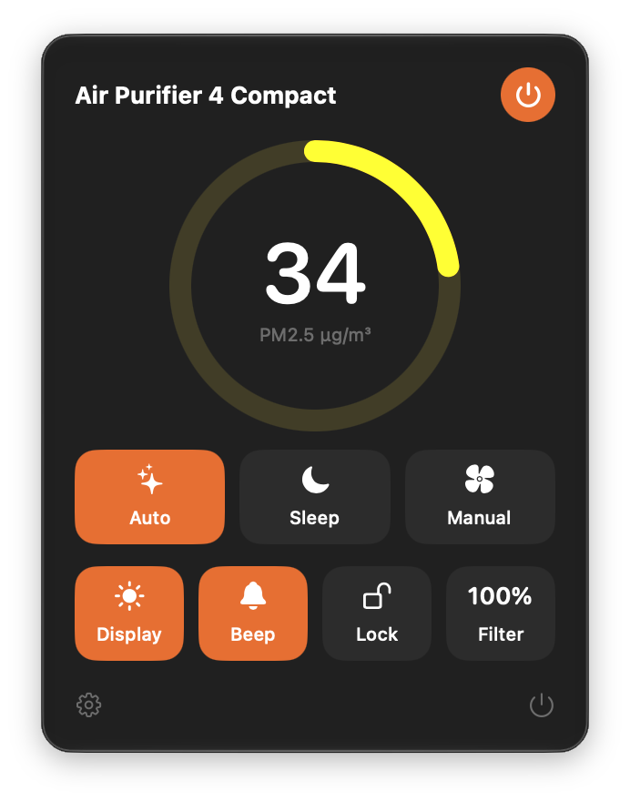

<p align="center"></p>

<h1 align="center">Purifier Bar</h1>

<p align="center">Your Xiaomi air purifier's PM2.5 in the macOS menu bar, with controls one click away.</p>

<p align="center"></p>

## Features

- Live PM2.5 in the menu bar
- Power, Auto / Sleep / Manual, fan level, display, beep, child lock, filter life
- Open at login
- Sign in by scanning a QR code with Mi Home. No password needed.
- Talks to the purifier directly on your Wi-Fi. The cloud is only used once, to find its token.

## Supported devices

Xiaomi Smart Air Purifier 4 Compact (`zhimi.airp.cpa4`, `xiaomi.airp.cpa4`) and 4 Lite (`zhimi.airp.rmb1`).

## Install

Requires macOS 14+ and Xcode command line tools.

```bash
git clone https://github.com/umarz317/purifier-bar.git
cd purifier-bar
./build.sh --install
```

Click the menu bar icon → **Sign in with Mi Home** → scan the code in Mi Home. Allow Local Network access when macOS asks.

## Credits

The cloud sign-in is ported from [Xiaomi-cloud-tokens-extractor](https://github.com/PiotrMachowski/Xiaomi-cloud-tokens-extractor). Not affiliated with Xiaomi.

## License

MIT
